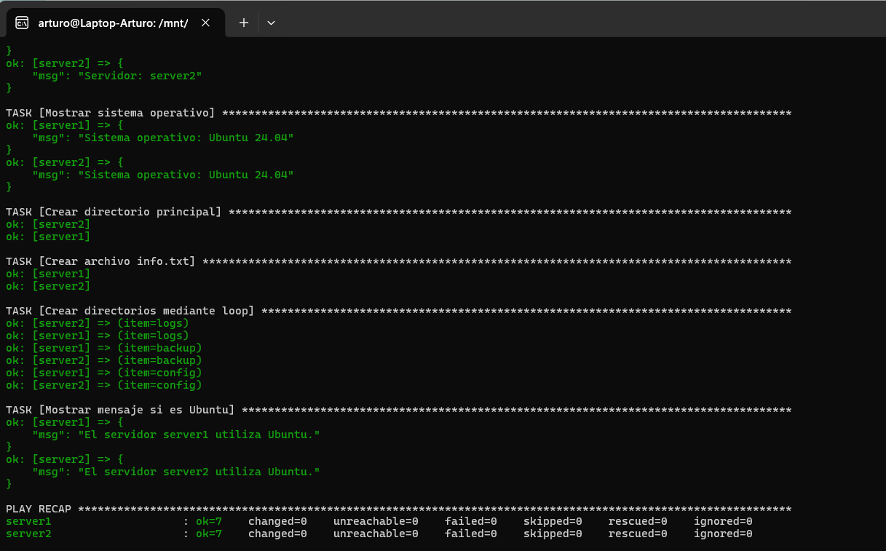

# Laboratorio Docker y Ansible

## Objetivo
Crear un laboratorio con dos servidores Linux Ubuntu 24.04
utilizando Docker y administrarlos mediante Ansible.

## Tecnologías utilizadas
- Docker
- Docker Compose
- Ansible
- Ubuntu 24.04

## Iniciar los servidores
```bash
docker compose up -d
```

## Verificar los contenedores
```bash
docker ps
```

## Ejecutar el playbook
```bash
ansible-playbook -i inventory.ini playbook.yml
```

## Tareas automatizadas
1. Mostrar el nombre de cada servidor.
2. Mostrar el sistema operativo.
3. Crear /tmp/ansible-demo.
4. Crear el archivo info.txt.
5. Crear logs, backup y config mediante un loop.
6. Mostrar un mensaje cuando el sistema sea Ubuntu.

## Evidencia de ejecución

La siguiente captura muestra la ejecución exitosa
del playbook en ambos servidores Ubuntu 24.04.



## Resultado
El laboratorio permite administrar dos contenedores
Ubuntu mediante tareas automatizadas con Ansible.
